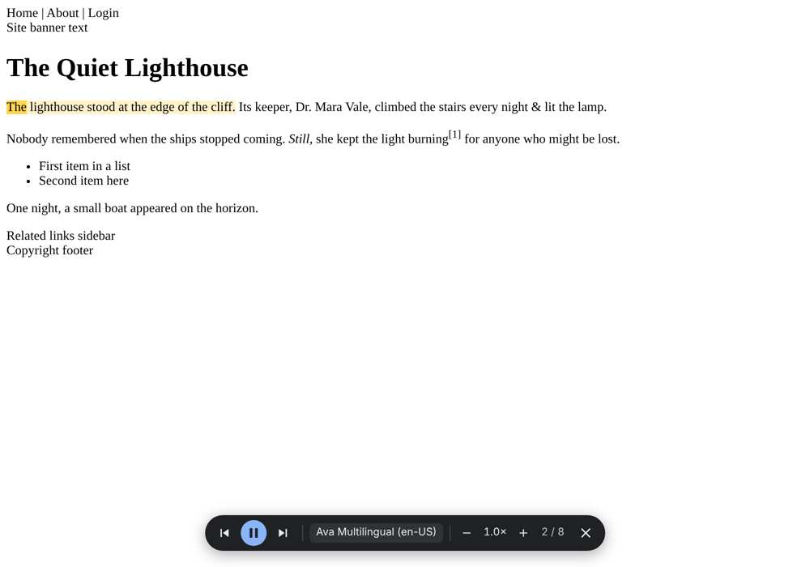

# Read Aloud Anywhere (personal)

> **Personal project — not for use or distribution.**
> I built this for myself and published it only to show how it works. It isn't supported and isn't
> on any extension store. It relies on an **undocumented** service that can change or disappear at any
> time, and **it will break** when that happens. Please don't use, fork, or redistribute it.
> All rights reserved — no license is granted.

## Why

I moved from Edge to Brave for everything else, but I missed one Edge feature: **Read Aloud**. Its
natural neural voices are far better than the robotic system voices other browsers use. Switching
browsers for one feature didn't make sense, so I rebuilt the feature as a small extension. Then I
brought the same voices into VS Code for reading docs.

| Folder | What it is |
|---|---|
| [`browser/`](browser) | Brave/Chromium extension: reads web pages with sentence and word highlighting |
| [`vscode/`](vscode) | VS Code extension: reads Markdown/docs, only the comments in code, and Claude Code replies |
| [`shared/`](shared) | The voice engine both use: request token, constants, SSML, and the connection/protocol client |

`shared/` is the single source of truth: both extensions import it directly, and there are no
copies. GitHub Actions bundles each extension (with [esbuild](https://esbuild.github.io)), tests the
built result, and publishes both install files as a release (see [Installing](#installing)).

## Browser extension

- Reads the main article on a page (skipping nav, sidebars, footers and hidden text), or just the
  selected text
- Highlights the sentence being read, and the current **word** in real time
- Floating player bar: play/pause, previous/next sentence, voice picker, speed
- **Right-click → "Read aloud from here"** starts at that word and reads on through the page
- **Ctrl+Shift+U** (⇧⌘U on Mac) to start, pause or resume. Alt/Option+click a sentence while
  reading to jump to it
- Popup with language and voice picker, voice preview, speed, pitch, and highlight/scroll options



```
page (content.js)            background.js               offscreen.html (offscreen.js)
─────────────────            ─────────────               ─────────────────────────────
extract text → sentences ──▶ routes messages,      ──▶  one reused WebSocket → MP3 + word timings
CSS Custom Highlight API ◀── relays player events  ◀──  plays audio, prefetches next 2 sentences,
floating player (shadow DOM) context menu, shortcut      reports sentence/word progress
```

## VS Code extension

- **Markdown / plain text:** reads the prose. It skips syntax, URLs, images, HTML and fenced code.
- **Code:** reads **only comments and docstrings**, and skips lines that look like commented-out
  code.
- **Claude Code replies:** reads the latest reply of the session you're looking at (⌘⌥U), reads
  from a word you select or right-click in the Claude panel, or auto-reads each reply when it
  finishes. Tool calls, thinking and code are
  skipped. Replies come from Claude Code's local session files (read-only), since its chat panel
  can't be read by other extensions.
- Right-click → **Read Aloud from Here** (or **Read Aloud Selection**), ⌘⌥R to start or pause,
  and the sentence and word are highlighted in the editor.
- No runtime dependencies at all. It uses a hand-written WebSocket client on Node's `https`, and the
  OS audio player (`afplay` on macOS).

## Interesting problems

- **Speaking like Edge.** The voice service expects Edge's own client. In the browser,
  `declarativeNetRequest` sets the WebSocket handshake headers (Origin, User-Agent) that browser
  JavaScript isn't normally allowed to set. In VS Code, the hand-rolled WebSocket client sets them
  directly. Both generate the time-based request token the service requires (`shared/drm.js`).
  That's a port of the open-source [edge-tts](https://github.com/rany2/edge-tts) project's
  implementation, checked against its output.
- **Mapping audio back to text.** In the browser, text from DOM text nodes goes into a flat string
  with a 1:1 offset map back to the nodes. In VS Code, the document becomes "spoken text" of the
  *same length*, with skipped syntax and code blanked out, so offsets map straight back to editor
  ranges. Word-boundary events from the service become ranges, highlighted live.
- **Working on any site.** Styles come from extension APIs and constructable stylesheets (no inline
  styles), and UI is built with DOM APIs (no `innerHTML`). That keeps it working on pages with strict
  Content-Security-Policy or Trusted Types.
- **No stalls between sentences.** Both extensions keep **one** connection open, the way Edge
  does, and send the current sentence and the next two on it at once: the service works on them in
  parallel (tagged by request id). Measured against the real service, some voices (including the
  default, Ava Multilingual) take 3–13 s to start a new sentence, about as long as a sentence takes
  to play, so asking one at a time left long gaps. More than ~3 at once, or bursts of new
  connections, can make the service stop answering for a while. This logic is written once, in
  `shared/edge-client.js`; each extension only supplies its WebSocket.
- **Slow isn't stalled.** The service acknowledges a request within ~100 ms, so no reply at all
  within 5 s means a dead connection: the request is retried on a new one. Once acknowledged, it
  waits up to 20 s for audio (the old single 5 s limit failed 4–8 of every 12 sentences with the
  default voice, and the retry made each of them take twice as long).
- **No handshake wait on the next read.** The connection is opened while the text is still being
  extracted, and stays open for 30 s after reading stops. Stopping, skipping or changing speed
  lets the cancelled sentence finish arriving in the background instead of closing the connection.
  The browser also keeps the last 40 sentences it spoke, so going back or reading again is instant.
- **Fast start.** The browser streams audio into a `MediaSource` as it arrives, so speech starts
  with the first chunk rather than after the whole sentence. The audio player is also warmed up while
  the page script loads. A long sentence to start at is split at a natural pause, since the service
  takes longer to start the longer the sentence (a 30-word opening: first sound 7.8 → 4.8 s).
- **Long pages.** Text extraction builds one flat string from the page's text nodes. Testing the end
  of that string with a regex made V8 copy the whole string each time, so a long page took
  seconds; tracking the last character instead made it ~20× faster.
- **Testable without the real service.** A local fake speech server (TLS + hand-rolled WebSocket
  framing) runs end-to-end tests for both extensions. That covers header rewriting, the token, the
  protocol, playback, highlighting, selection, speed changes, and jumping. Separate live tests and
  a live benchmark run the same code against the real service (see below); they use new random
  text each run, because the service caches audio for text it has seen (a repeat takes ~150 ms).

## Security & privacy

Extensions are a common attack route, so this one is kept deliberately small:

- **Minimal browser permissions.** It uses `activeTab`, so it can only touch the tab you invoke it
  on, at that moment. There's no "read all sites" access and no always-on script; "Read aloud from
  here" uses the word your right-click selects. Network access is limited to the voice service's
  domains.
- **No remote code, no tracking.** All code ships in the folder: no `eval`, no external scripts, no
  analytics.
- **Web pages can't control it.** There's no `externally_connectable`. Page text is XML-escaped
  before going into SSML, and the player UI never uses `innerHTML`.
- **No silent updates.** It's installed by hand from this repo's releases, not from a store, so
  nobody can push an update to it. Updating means downloading a new build yourself.
- **No runtime dependencies.** The extensions ship only this repo's code. The one build tool
  (esbuild) is pinned to an exact version in `package-lock.json` and installed with
  `--ignore-scripts`, and its output isn't minified, so the installed code stays readable. (Tests
  use Playwright, which is test-only.)
- **What leaves your machine:** the text being read goes to Microsoft's speech service, the same as
  Edge's Read Aloud. That includes Claude Code replies when you read them aloud, so don't use it on
  confidential content. Claude Code session files are only read locally, never uploaded or
  modified. An Azure key (optional) stays in the
  browser's local extension storage, or in VS Code's encrypted secret storage.

## When it breaks

The free endpoint is unofficial, so expect breakage. The usual fix is to bump the version constants
in `shared/constants.js` and/or port the latest token change into `shared/drm.js` from a newer
edge-tts release, then push. The next build fixes both extensions.

There's an official fallback built into both: switch the voice source to *Azure Speech key*. Azure
Speech has a free tier with the same neural voices. Word highlighting isn't available there.

## Installing

Every push to `main` is tested and built by GitHub Actions ([`build.yml`](.github/workflows/build.yml)),
which publishes it as a release (only the newest build is kept). No Node.js needed on your machine.
From [**Releases → latest**](https://github.com/sahilkoditkar/read-aloud-anywhere/releases/latest), download:

- **Browser:** `read-aloud-browser-<version>.zip`. Unzip it, then `brave://extensions` →
  **Developer mode** → **Load unpacked** → pick the `read-aloud-browser` folder. To update, unzip the
  new build over the same folder and press the reload icon on the extension (same folder = same
  extension, so your settings stay). It can't run on `brave://` pages, the extension store, or the
  built-in PDF viewer.
- **VS Code:** `read-aloud-vscode-<version>.vsix`. In VS Code: **Extensions** → **⋯** →
  **Install from VSIX…**

To build a branch, run the workflow by hand: **Actions** → **Build** → **Run workflow**. That makes
a draft release (visible only to you), so it doesn't replace the published one.

## Building and testing (optional, needs Node.js 18+)

```bash
npm ci --ignore-scripts
npm run build                          # -> dist/*.zip, dist/*.vsix, dist/browser (unpacked)
npm test                               # unit tests
node vscode/tests/bundle.test.cjs      # the built VS Code extension loads
node browser/tests/e2e/run.js          # needs Playwright, openssl, ffmpeg, port 443
node vscode/tests/extension.test.cjs   # needs openssl, ffmpeg, port 443
```

**Benchmarks** (fake service with simulated latency, and large generated inputs):

```bash
node browser/tests/e2e/bench.js   # first word, gaps, a 1.5 MB page
node vscode/tests/bench.mjs       # Claude Code transcripts, long Markdown
```

**Against the real service** (these send text to Microsoft, so CI doesn't run them; they use
`HTTPS_PROXY` if set):

```bash
node vscode/tests/live.test.mjs                  # voices, token + clock fix, escaping, languages, speed, long text, cancel
node browser/tests/e2e/live.js                   # the built extension in Chromium: reads a page, highlights words
node vscode/tests/live-bench.mjs --mode stream   # first sound, silences, failures while reading an article (browser)
node vscode/tests/live-bench.mjs --mode file     # the same, playing whole files (VS Code)
```

Each takes `--root <checkout>` to measure another version (e.g. a `git worktree` of an older
commit) the same way, and the benchmarks take `--voice`, `--runs` and `--json`.
